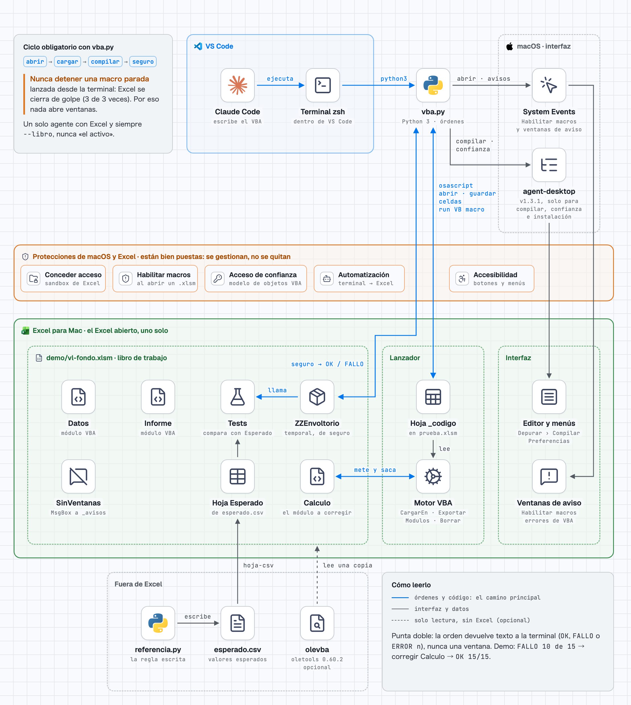
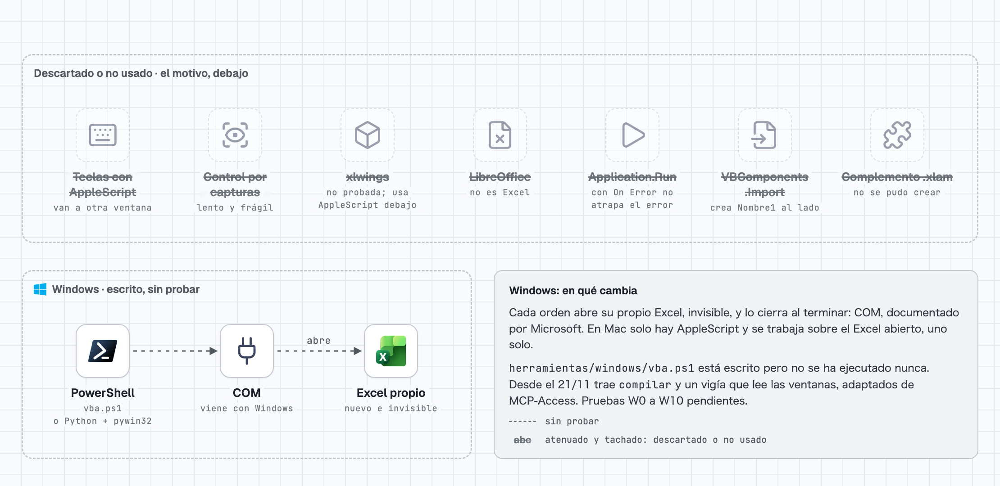

# Ejecutar VBA desde Claude Code

Si eres una IA o vas a usarlo: lee [AGENTS.md](AGENTS.md) (orden de lectura) y
[docs/08-aprendizajes.md](docs/08-aprendizajes.md).

Claude Code escribe código VBA como texto, lo mete en un libro de Excel, lo ejecuta y recibe el
resultado en la terminal, sin copiar y pegar. El resultado se valida contra una referencia
independiente en Python. Nace de un problema planteado por una profesora de Estadística (y matemática): se decía que una IA
no puede ejecutar VBA porque vive dentro de Excel y, sobre todo, no había forma de **validar** las
correcciones que propone. Problema y vías propuestas: [docs/01-contexto.md](docs/01-contexto.md).

Repositorio: <https://github.com/miguelgraande/vba-excel-claude-code>.

Esto sirve para mantener una herramienta VBA que ya existe. Para algo nuevo no recomendamos VBA: ver
[docs/07-vba-python-power-bi.md](docs/07-vba-python-power-bi.md).

## Resultado demostrado

Probado en Mac el 14/11/2026 con una herramienta inventada de valor liquidativo que tiene un error
escondido (base 360 en vez de 365):

```text
compilar               ->  OK compila vl-fondo.xlsm
seguro EjecutarTests   ->  FALLO 10 de 15: 2025-03-10 … 2025-03-21
exportar Calculo       ->  línea 9: TasaDiaria = ComisionPctDia(fila) / 100 / 360
cargar (corregido)     ->  OK Calculo 53 lineas
compilar               ->  OK compila vl-fondo.xlsm
seguro EjecutarTests   ->  OK 15/15
seguro GenerarInforme  ->  OK Informe 15 dias
```

El guion `demo/ejecutar_demo.py` hace todo el ciclo y terminó en `DEMO CORRECTA` con y sin
`--sin-compilar`. Pruebas y salidas literales: [docs/04-resultados.md](docs/04-resultados.md).

Para ver el resultado final sin ejecutar nada, abre `demo/vl-fondo-corregido.xlsm`: es el después de la
demo, con `Calculo` corregido, tests 15/15 e informe. Se abre en la hoja `Informe`. El antes es
`demo/vl-fondo.xlsm`, con el error.

## Requisitos

- macOS con Excel para Mac (probado: macOS 26.6.2, Excel 16.115).
- Excel con la interfaz en castellano (las órdenes `compilar`, `confianza` y `abrir` buscan botones por
  su nombre).
- Mac con Apple Silicon (probado). En Intel hay binario de agent-desktop, sin probar.
- Python 3 (probado con 3.14). Sin dependencias.
- Ajuste de Excel "Acceso de confianza al modelo de objetos de proyectos de VBA", activado solo
  mientras se trabaja (`vba.py confianza activar|desactivar`).
- Permisos de macOS de Automatización y Accesibilidad para la terminal.
- La carpeta fuera de iCloud (o "Mantener descargado") y con espacio en disco
  ([por qué](docs/05-buenas-practicas.md#a-reglas-de-oro), regla 13).
- [agent-desktop](https://github.com/vercel-labs/agent-desktop) v1.3.1, para las órdenes `compilar` y
  `confianza`.

Detalle de cada permiso: [docs/05-buenas-practicas.md](docs/05-buenas-practicas.md#b-permisos).
Instalación paso a paso: [docs/09-instalacion.md](docs/09-instalacion.md).

## Inicio rápido

**¿Usas Windows?** La demo es de Mac. Sigue [docs/10-probar-en-windows.md](docs/10-probar-en-windows.md).

**La forma más rápida de verlo funcionar (Mac):** abre la carpeta con Claude Code y te ofrecerá ejecutar el
ejemplo. O lánzalo tú, con Excel abierto y el ajuste de confianza activado:

```bash
python3 -I demo/ejecutar_demo.py        # FALLO 10 de 15 -> corrección -> OK 15/15 -> DEMO CORRECTA
```

Sin agent-desktop, añade `--sin-compilar`. Si `compilar` devuelve `ERROR COMPILACION` o `ERROR VENTANA`,
el guion para sin ejecutar los tests. Al terminar, el libro vuelve a la versión con el error, con sus
hojas `Tests` e `Informe` coherentes con ella (`FALLO 10 de 15`).

El mismo ciclo, orden a orden y a mano:
[docs/03-solucion-mac.md, ciclo de trabajo](docs/03-solucion-mac.md#ciclo-de-trabajo). Al terminar,
desactiva el ajuste: `python3 -I herramientas/vba.py confianza desactivar`.

La solución de la demo está en `demo/solucion/`. Este README y `docs/` también revelan el error: para
probar que Claude lo encuentra solo, ver
[docs/01-contexto.md](docs/01-contexto.md#lo-que-todavía-no-está-demostrado).

Regla principal: **nunca detener una macro lanzada desde la terminal que se ha parado**; cierra Excel.
Por eso el orden es siempre `cargar` → `compilar` → `seguro`.

## Documentos

| Documento | Qué contiene |
|---|---|
| [AGENTS.md](AGENTS.md) | Entrada para una IA: qué es, orden de lectura, herramientas, ciclo y reglas |
| [docs/08-aprendizajes.md](docs/08-aprendizajes.md) | **Empieza aquí si vas a usarlo**: la manera adecuada, por qué se rompe si no se sigue y qué descartamos |
| [docs/09-instalacion.md](docs/09-instalacion.md) | Instalación en un Mac nuevo, paso a paso: qué usar, en qué orden y cómo comprobarlo |
| [docs/01-contexto.md](docs/01-contexto.md) | El problema planteado, las vías propuestas, lo demostrado y lo que falta por demostrar |
| [docs/02-recorrido.md](docs/02-recorrido.md) | El camino seguido, por etapas: qué se intentó, qué pasó y qué se decidió |
| [docs/03-solucion-mac.md](docs/03-solucion-mac.md) | La solución pieza a pieza, preparación, ciclo de trabajo, órdenes y demo |
| [docs/04-resultados.md](docs/04-resultados.md) | Todas las pruebas con su evidencia, lo que no funcionó y las alternativas evaluadas |
| [docs/05-buenas-practicas.md](docs/05-buenas-practicas.md) | Reglas de oro, permisos, solución de problemas por síntoma, recuperación, buenas prácticas al escribir VBA y glosario |
| [docs/06-windows.md](docs/06-windows.md) | Vía Windows por COM, sus scripts y sus riesgos. Sin probar por nosotros |
| [docs/10-probar-en-windows.md](docs/10-probar-en-windows.md) | **Si usas Windows:** estado, qué falta y las pruebas W0 a W11 con órdenes exactas y salidas esperadas |
| [docs/07-vba-python-power-bi.md](docs/07-vba-python-power-bi.md) | Opinión: cuándo VBA, cuándo Python o Power BI, la alternativa de una aplicación a medida en Python y el plan por fases para migrar una herramienta heredada. No probado |
| [docs/00-plan-inicial.md](docs/00-plan-inicial.md) | Plan original del 13/11 con la lista de pruebas. Histórico |
| [docs/bitacora.md](docs/bitacora.md) | Hechos de la sesión del 14/11, en orden y con evidencia. Fuente de los demás |
| [demo/ESPECIFICACION.md](demo/ESPECIFICACION.md) | La demo de valor liquidativo: regla de negocio, datos e incidencia |

## Estructura

```text
.
├── README.md               esta portada
├── AGENTS.md               entrada para una IA
├── CLAUDE.md               importa AGENTS.md para Claude Code
├── LICENSE                 licencia MIT
├── .gitattributes          trata los .xlsm y .xlsb como binarios
├── .gitignore              excluye temporales de Excel y el material local
├── prueba.xlsm             libro lanzador: Motor, Módulo1 (cargadora), PruebaErrores y SinVentanas
├── docs/                   documentación (00 a 09) y bitácora
├── diagrama/               diagramas de arquitectura, su fuente editable y cómo reconstruirlos
├── herramientas/
│   ├── vba.py              órdenes de terminal para Mac
│   ├── requirements-olevba.txt  dependencias congeladas de olevba (opcional)
│   └── windows/
│       ├── vba.ps1         equivalente para Windows (le funcionó a la profesora; sin probar por nosotros)
│       └── vba-nuevo.ps1   vba.ps1 + compilar y vigía de ventanas (experimental, sin ejecutar)
├── vba/
│   ├── Motor.bas           carga, exporta, lista y borra módulos
│   ├── Cargadora.bas       primera macro, se pega a mano una vez
│   ├── SinVentanas.bas     MsgBox e InputBox sin ventana
│   └── pruebas/            módulos y libro (errores.xlsm) usados para provocar errores
└── demo/                   demo del valor liquidativo (módulos, datos, referencia Python)
    ├── vl-fondo.xlsm       el antes: libro de la demo, con el error
    ├── vl-fondo-corregido.xlsm  el después: Calculo corregido, tests 15/15 e informe
    ├── ejecutar_demo.py    demo guiada de principio a fin
    └── solucion/           solución de la demo (SOLUCION.md, Calculo_corregido.bas)
```

## Lo que todavía no está demostrado

Detalle y porqué en [docs/01-contexto.md](docs/01-contexto.md#lo-que-todavía-no-está-demostrado).

1. **Que Claude encuentre el error sin saber dónde está.** En la prueba, la sesión ya conocía el error
   porque lo diseñó. Falta una sesión limpia que solo reciba la incidencia y llegue sola a `OK 15/15`.
2. **Windows.** La vía COM está preparada. Le funcionó a la profesora (informe de terceros, sin salida),
   pero nosotros no la hemos probado: las pruebas están en
   [docs/10-probar-en-windows.md](docs/10-probar-en-windows.md). En un portátil de empresa, informática
   puede bloquear el ajuste de confianza.
3. **La herramienta real.** Más grande y de 2015. Con muchos `MsgBox`, formularios o errores sin
   controlar habrá que aplicar `compilar`, `seguro` y SinVentanas, que no cubre formularios ni
   `Application.InputBox`.

## Estado y límites

- **Mac: funciona el ciclo completo** (pruebas M1 a M8 en [docs/04-resultados.md](docs/04-resultados.md)).
- **Windows: sin probar por nosotros.** `vba.ps1` le funcionó a la profesora (nos lo contaron, sin la
  salida). `vba-nuevo.ps1` añade `compilar` y un vigía de ventanas, sin ejecutar. Lo que falta son las
  pruebas: [docs/10-probar-en-windows.md](docs/10-probar-en-windows.md).
- Solo libros con datos inventados. Antes de usarlo con una herramienta real, hace falta el permiso de la organización propietaria.
- SinVentanas no cubre `Application.InputBox`, formularios ni diálogos de Excel.
- `compilar` a veces responde `SIN VERIFICAR` (causa sin aclarar). Responde `OK compila <libro>`;
  antes de su corrección del 14/11 podía compilar otro libro
  ([por qué](docs/08-aprendizajes.md#un-ok-solo-vale-si-se-sabe-de-qué-es)).
- Algunas órdenes ponen Excel delante (`compilar`, `confianza`, `abrir`, `dialogos` y la vigilancia de
  avisos): con Excel en segundo plano, macOS no deja ver sus ventanas. Al terminar devuelven el foco a la
  aplicación que estaba delante, también si hay error.
- Excel escribe el autor y la ruta de la carpeta en el libro en cada guardado. Antes de publicar libros,
  limpiarlos con los libros cerrados ([docs/05-buenas-practicas.md](docs/05-buenas-practicas.md#antes-de-publicar-o-compartir-un-libro)).
  `vbaProject.bin` conserva una referencia de MSForms con la ruta de la carpeta del usuario del Mac
  donde se crearon los libros: límite conocido, se dejan así a propósito.
- Excel pregunta "Habilitar macros" cada vez que se abre un libro desde disco. `vba.py abrir` lo pulsa;
  moverlo a un complemento `.xlam` no se consiguió.
- Las órdenes buscan menús y botones por su texto en castellano.

## Arquitectura

<picture>
  <source media="(prefers-color-scheme: dark)" srcset="diagrama/arquitectura-dark.png">
  
</picture>

Ciclo obligatorio: `abrir -> cargar -> compilar -> seguro`. Nunca detener una macro parada lanzada desde la terminal: Excel se cierra de golpe.

<picture>
  <source media="(prefers-color-scheme: dark)" srcset="diagrama/descartado-windows-dark.png">
  
</picture>

Fuente editable y cómo reconstruir los diagramas: [diagrama/README.md](diagrama/README.md). Hechos con [stack-diagram](https://github.com/caru-ini/stack-diagram).

## Licencia

MIT, ver [LICENSE](LICENSE).
